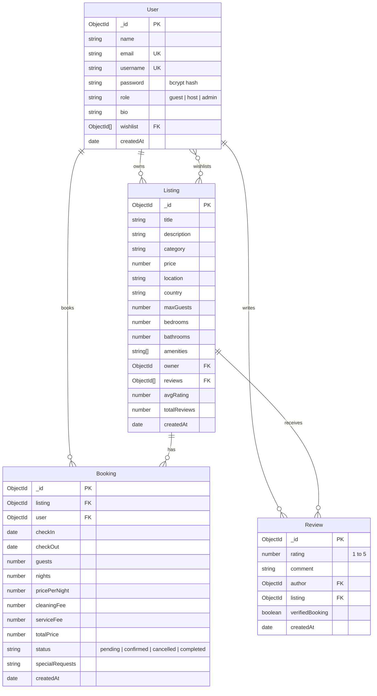

<div align="center">

# 🌍 WanderLust

### *Full-Stack Vacation Rental & Booking Platform*

An Airbnb-inspired full-stack web application designed for discovering, listing, and booking vacation properties worldwide. Built with a production-grade **MVC (Model-View-Controller) architecture**, role-based access control, conflict-free booking logic, verified reviews, and real-time pricing calculations.

---

### 🚀 **[Explore the Live Demo](https://wanderlust-tklw.onrender.com)** 🚀

[](https://wanderlust-tklw.onrender.com)
[](https://github.com/roit37/WanderLust)

<br/>

[](https://nodejs.org/)
[](https://expressjs.com/)
[](https://www.mongodb.com/atlas)
[](https://mongoosejs.com/)
[](https://ejs.co/)
[](https://getbootstrap.com/)
[](https://nodejs.org/api/test.html)
[](LICENSE)

</div>

---

## 📑 Table of Contents

- [Overview](#-overview)
- [Live Demo & Quick Access](#-live-demo--quick-access)
- [Key Features](#-key-features)
- [Technology Stack](#-technology-stack)
- [System Architecture & Folder Structure](#-system-architecture--folder-structure)
- [Database Schema Design](#-database-schema-design)
- [Getting Started (Local Development)](#-getting-started-local-development)
- [Environment Configuration](#-environment-configuration)
- [MongoDB Atlas Setup Guide](#-mongodb-atlas-setup-guide)
- [Deployment on Render](#-deployment-on-render)
- [Pre-Configured Demo Accounts](#-pre-configured-demo-accounts)
- [Automated Testing](#-automated-testing)
- [Future Improvements & Roadmap](#-future-improvements--roadmap)
- [Author & Acknowledgments](#-author--acknowledgments)

---

## 🌟 Overview

**WanderLust** is a feature-rich vacation rental marketplace that connects travelers looking for unique stays with property hosts offering homes, villas, cabins, and beachfront retreats. Built with a focus on real-world software engineering practices, WanderLust demonstrates end-to-end full-stack development using Node.js, Express 5, MongoDB Atlas, and responsive EJS templates styled with Bootstrap 5.

### What Makes This Project Stand Out:
- **Production-Grade MVC Structure**: Clean separation of routes, controllers, services, models, validators, and middlewares.
- **Strict Authorization & Role Management**: Multi-tier access for Guests, Hosts, and Platform Administrators.
- **Double-Booking Prevention**: Date-range overlap detection algorithms running at the database service level.
- **Verified Review Engine**: Automatically flags reviews with a "Verified Stay" badge when the user has completed a stay at the listing.
- **Enterprise-Grade Security**: Content Security Policy via Helmet, Express Rate Limiting, payload sanitization against XSS, and encrypted session storage.

---

## 🔗 Live Demo & Quick Access

The application is deployed and running live on Render:

- **🌐 Live URL**: [https://wanderlust-tklw.onrender.com](https://wanderlust-tklw.onrender.com)
- **💻 Source Code**: [https://github.com/roit37/WanderLust](https://github.com/roit37/WanderLust)

> **Note**: Free cloud tier instances on Render may spin down during inactivity and take 20–40 seconds to handle the initial request.

---

## ✨ Key Features

### 1. Multi-Tier Authentication & Access Control
- **User Roles**: `Guest`, `Host`, and `Admin`.
- **Password Security**: Strong salt hashing with `bcryptjs` before persisting to database.
- **Stateful Persistent Sessions**: Managed via `express-session` and persisted in MongoDB using `connect-mongo`.
- **Protected Middleware Pipeline**:
  - `isLoggedIn` & `isLoggedOut` guards with intelligent post-login redirect recovery (`returnTo`).
  - `isHost` verification before accessing property creation tools.
  - `isListingOwner` preventing unauthorized edits or deletions.
  - `isBookingParty` restricting reservation access to the booking guest, the host, or an admin.
  - `isAdmin` safeguarding system moderation panels and global metrics.

### 2. Property Management & Dynamic Discovery
- **Comprehensive Listing Schema**: Title, description, cover image, category, nightly price, location, country, guest capacity, bedrooms, bathrooms, and customizable amenities.
- **Cloud Image Uploads**: Cloudinary integration with `multer-storage-cloudinary` for cloud media management, paired with automatic local disk storage and external image URL fallback.
- **Instant Search & Category Filtering**:
  - Full-text search matching title, location, country, or description.
  - 12 category chips (*Beachfront, Iconic Cities, Mountains, Castles, Amazing Pools, Camping, Farms, Arctic, Domes, Rooms, Luxury, Trending*).
  - Price range filter (*Min Price & Max Price*) and guest capacity filtering.
  - Sorting by newest, price (low-to-high, high-to-low), and top customer ratings.
  - Server-side pagination with dynamic page controls.

### 3. Conflict-Free Booking Engine
- **Availability & Date-Overlap Guard**: Detects and rejects conflicting booking dates (`[checkIn, checkOut)`) against existing confirmed reservations.
- **Self-Booking Protection**: Prevents hosts from reserving their own properties.
- **Dynamic Pricing Engine**:
  - Computes stay duration in nights.
  - Automatically calculates accommodation cost, cleaning fee (₹500), and platform service fee (5%).
  - Client-side interactive booking widget with live price recalculation on date change.
- **Reservation Lifecycle**: `pending` → `confirmed` → `completed` / `cancelled`.

### 4. Verified Reviews & Ratings
- 1-to-5 star rating submission with written feedback.
- **Verified Guest Badge**: Cross-references booking history so travelers who completed stays at the property receive a "Verified Stay" badge on their review.
- Automated average rating (`avgRating`) and total review counter recalculation.
- Cascade deletion: Removing a listing automatically purges all related review documents.

### 5. Multi-User Dashboards & Wishlists
- **Guest Dashboard**: Profile details, active/upcoming trip counters, past trip receipts, and 1-click upgrade to Host role.
- **Host Dashboard**: Property performance overview, gross payout statistics, listed properties management, and incoming guest reservations with status actions (*Confirm, Complete, Decline*).
- **Admin Panel**: Platform KPIs (total users, listings, bookings, platform volume), user role switching, user deletion, and content moderation.
- **User Wishlist**: 1-click toggle to save favorite stays and review them from a dedicated wishlist view.

### 6. Security Hardening
- **Helmet**: Customized Content Security Policy (CSP) whitelisting Bootstrap CDN, FontAwesome, Google Fonts, and CDNs (Unsplash, Cloudinary).
- **Rate Limiting**: `express-rate-limit` protecting against brute-force authentication and general DDoS attempts.
- **XSS Protection**: HTML sanitization on body payloads via `sanitize-html`.
- **Method Override**: Enables RESTful `PUT` and `DELETE` requests from HTML forms.
- **Custom 404 & 500 Pages**: Clean error rendering with informative developer stack traces in development mode.

---

## 🛠️ Technology Stack

| Layer | Technologies |
| :--- | :--- |
| **Backend Runtime** | [Node.js](https://nodejs.org/) (v18+) |
| **Web Framework** | [Express.js 5](https://expressjs.com/) (RESTful routing, CommonJS) |
| **Database & ODM** | [MongoDB Atlas](https://www.mongodb.com/atlas) & [Mongoose 9](https://mongoosejs.com/) |
| **Templating Engine** | [EJS](https://ejs.co/) & [EJS-Mate](https://github.com/JacksonTian/ejs-mate) (Reusable layouts & boilerplate) |
| **Frontend Styling** | [Bootstrap 5.3](https://getbootstrap.com/), Custom CSS3, [Font Awesome 6.6](https://fontawesome.com/) |
| **Client-Side Scripting** | Vanilla JavaScript (ES6+, dynamic price calculations, form validation) |
| **Authentication & Security** | [bcryptjs](https://github.com/dcodeIO/bcrypt.js), [Helmet](https://helmetjs.github.io/), [express-rate-limit](https://github.com/express-rate-limit/express-rate-limit), [sanitize-html](https://github.com/apostrophecms/sanitize-html) |
| **Session Management** | [express-session](https://github.com/expressjs/session), [connect-mongo](https://github.com/jdesboeufs/connect-mongo), [connect-flash](https://github.com/jaredhanson/connect-flash) |
| **File Uploads** | [Multer](https://github.com/expressjs/multer), [Cloudinary](https://cloudinary.com/), `multer-storage-cloudinary` |
| **Validation** | [Joi](https://joi.dev/) (Server-side schema validation) |
| **Testing** | Node.js Test Runner (`node:test`), [Supertest](https://github.com/ladjs/supertest) |
| **Hosting & Cloud** | [Render](https://render.com/) (Web Service), MongoDB Atlas (Database) |

---

## 🏛️ System Architecture & Folder Structure

WanderLust strictly implements the **Model-View-Controller (MVC)** architectural pattern:

```text
MAJORPROJECT/
├── config/
│   ├── db.js                 # MongoDB Atlas connection handler
│   ├── cloudinary.js         # Cloudinary configuration & Multer storage fallback
│   └── session.js            # Express session & connect-mongo store setup
├── controllers/
│   ├── listings.js           # Property CRUD, image handling, search & filter
│   ├── bookings.js           # Reservation lifecycle, guest & host trips
│   ├── reviews.js            # Review creation, verified check & avg rating
│   ├── users.js              # Register, login, logout, profile update
│   ├── dashboards.js         # Guest, Host, and Admin dashboard views
│   └── wishlists.js          # Saved properties toggle & wishlist view
├── middleware/
│   ├── auth.js               # isLoggedIn, isHost, isAdmin, isListingOwner, etc.
│   ├── validate.js           # Joi payload validation middleware
│   ├── sanitize.js           # Input sanitization against XSS
│   ├── rateLimiter.js        # Express rate limiters (general & auth)
│   └── errorHandler.js       # Centralized 404 & global error handling
├── models/
│   ├── user.js               # User schema with bcrypt hashing & roles
│   ├── listing.js            # Property schema with cascade delete hook
│   ├── booking.js            # Booking schema with indexed overlap checks
│   └── review.js             # Review schema with verifiedBooking flag
├── routes/
│   ├── listings.js           # /listings endpoints
│   ├── reviews.js            # /listings/:id/reviews endpoints
│   ├── bookings.js           # /bookings endpoints
│   ├── users.js              # /register, /login, /logout, /profile
│   ├── dashboards.js         # /dashboard/guest, /host, /admin
│   └── wishlists.js          # /wishlist endpoints
├── services/
│   ├── bookingService.js     # Overlap checking & price calculation logic
│   └── listingService.js     # Query builder, filters, sorting & pagination
├── utils/
│   ├── ExpressError.js       # Custom operational error class
│   ├── catchAsync.js         # Async error wrapper
│   └── dateUtils.js          # Date overlap and night difference utilities
├── validators/
│   └── schemas.js            # Joi validation schemas
├── views/
│   ├── layouts/boilerplate.ejs
│   ├── includes/navbar.ejs, footer.ejs, flash.ejs
│   ├── listings/index.ejs, show.ejs, new.ejs, edit.ejs, home.ejs
│   ├── bookings/checkout.ejs, guestBookings.ejs, hostReservations.ejs
│   ├── dashboards/guest.ejs, host.ejs, admin.ejs
│   ├── users/register.ejs, login.ejs, profile.ejs
│   ├── wishlists/index.ejs
│   ├── pages/privacy.ejs, terms.ejs
│   └── errors/error.ejs
├── public/
│   ├── css/style.css         # Modern styling & responsive design
│   └── js/main.js            # Real-time booking calculator & validation
├── init/
│   ├── data.js               # Seed property data with categories & amenities
│   └── index.js              # Database seed script (Admin, Host, Guest, Listings)
├── tests/
│   └── app.test.js           # 28 Integration test cases
├── .env.example              # Environment variable documentation template
├── .gitignore                # Protects secrets & node_modules
├── app.js                    # Server entrypoint
└── package.json              # Project dependencies & scripts
```

---

## 🗄️ Database Schema Design



---

## 💻 Getting Started (Local Development)

Follow these step-by-step instructions to get a local copy up and running on your machine.

### Prerequisites
- **Node.js**: v18.x or higher ([Download Node.js](https://nodejs.org/))
- **MongoDB**: Local MongoDB community server running on port `27017` **OR** a free [MongoDB Atlas](https://www.mongodb.com/atlas) cluster
- **Git**: Installed on your system

### 1. Clone the Repository
```bash
git clone https://github.com/roit37/WanderLust.git
cd WanderLust
```

### 2. Install Dependencies
```bash
npm install
```

### 3. Setup Environment Variables
Create your local `.env` file from the provided template:
```bash
cp .env.example .env
```
*(Open `.env` in your text editor and adjust the values as outlined in the next section).*

### 4. Seed the Database
Populate your database with sample listings, categories, verified reviews, and demo users:
```bash
npm run seed
```

### 5. Start the Application
```bash
npm start
```
Open your browser and navigate to:
```
http://localhost:8080
```

---

## 🔐 Environment Configuration

Never commit your actual `.env` file or secrets to version control. Use the provided `.env.example` as a reference:

```env
# Server Configuration
PORT=8080
NODE_ENV=development

# Database Configuration (Local MongoDB or MongoDB Atlas)
# Local: mongodb://127.0.0.1:27017/wanderlust
# Atlas: mongodb+srv://<username>:<password>@cluster0.mongodb.net/wanderlust?retryWrites=true&w=majority
MONGODB_URI=mongodb://127.0.0.1:27017/wanderlust

# Session Secret (Use a strong random string in production)
SESSION_SECRET=your_super_secret_session_key_here

# Cloudinary Storage Configuration (Optional - fallback to local storage if omitted)
CLOUDINARY_CLOUD_NAME=your_cloudinary_cloud_name
CLOUDINARY_API_KEY=your_cloudinary_api_key
CLOUDINARY_API_SECRET=your_cloudinary_api_secret

# Default Admin Seed Credentials (used during database seeding)
ADMIN_NAME=Platform Administrator
ADMIN_EMAIL=admin@wanderlust.com
ADMIN_PASSWORD=Admin@123456
ADMIN_USERNAME=admin

# Default Demo Host & Guest Seed Credentials
HOST_EMAIL=host@wanderlust.com
HOST_PASSWORD=Host@123456
GUEST_EMAIL=guest@wanderlust.com
GUEST_PASSWORD=Guest@123456
```

---

## ☁️ MongoDB Atlas Setup Guide

To connect the application to a cloud-hosted MongoDB Atlas database:

1. **Create an Account**: Sign up at [MongoDB Atlas](https://www.mongodb.com/atlas).
2. **Build a Database Cluster**: Select the **Shared (M0 Free)** tier and choose your preferred cloud provider and region.
3. **Create Database User**:
   - Go to **Database Access** → **Add New Database User**.
   - Choose **Password** authentication.
   - Enter a username and secure password (e.g., `wanderlust_user`).
   - Grant **Read and write to any database** permissions.
4. **Configure Network Access**:
   - Go to **Network Access** → **Add IP Address**.
   - For local development and Render deployment, select **Allow Access from Anywhere** (`0.0.0.0/0`).
5. **Retrieve Connection String**:
   - In the **Database Deployments** screen, click **Connect** on your cluster.
   - Choose **Drivers** (Node.js).
   - Copy the connection string format:
     ```text
     mongodb+srv://<username>:<password>@cluster0.mongodb.net/wanderlust?retryWrites=true&w=majority
     ```
   - Replace `<username>` and `<password>` with your created database credentials.
6. **Set `MONGODB_URI`**: Paste the connection string into your `.env` file locally or inside the Render Environment settings.

---

## 🚢 Deployment on Render

This project is deployed as a Web Service on **Render** connected to **MongoDB Atlas**.

### Steps to Deploy:
1. **Push Code to GitHub**: Ensure your repository is up to date on GitHub (`https://github.com/roit37/WanderLust`).
2. **Create New Web Service on Render**:
   - Log into [Render](https://render.com/) and click **New +** → **Web Service**.
   - Connect your GitHub repository: `roit37/WanderLust`.
3. **Configure Build & Runtime Settings**:
   - **Environment**: `Node`
   - **Branch**: `main`
   - **Build Command**: `npm install`
   - **Start Command**: `npm start`
4. **Add Environment Variables in Render Dashboard**:
   - `NODE_ENV`: `production`
   - `PORT`: `10000` *(Render sets this automatically, but application reads `process.env.PORT`)*
   - `MONGODB_URI`: `<Your MongoDB Atlas connection URI>`
   - `SESSION_SECRET`: `<A long random cryptographically secure string>`
   - `CLOUDINARY_CLOUD_NAME`: *(Optional - your Cloudinary name)*
   - `CLOUDINARY_API_KEY`: *(Optional - your Cloudinary API key)*
   - `CLOUDINARY_API_SECRET`: *(Optional - your Cloudinary secret)*
5. **Deploy**: Click **Create Web Service**. Render builds the project, runs migrations, and serves the application live.

---

## 👥 Pre-Configured Demo Accounts

For quick evaluation without manual sign-up, the database seed script provides three ready-to-use demo accounts:

| Role | Email | Password | Username | Platform Permissions |
| :--- | :--- | :--- | :--- | :--- |
| **Admin** | `admin@wanderlust.com` | `Admin@123456` | `admin` | Full platform control, moderation, user role toggling |
| **Host** | `host@wanderlust.com` | `Host@123456` | `sarah_superhost` | Owns 16 seed properties, manages guest reservations |
| **Guest** | `guest@wanderlust.com` | `Guest@123456` | `alex_traveler` | Has pre-booked stays, wishlist items, and verified reviews |

> 💡 **Tip**: The login page (`/login`) includes **1-Click Demo Login** buttons to automatically sign in as any of the roles above without typing credentials.

---

## 🧪 Automated Testing

WanderLust includes an integration test suite built with Node's native test runner (`node:test`) and `supertest`.

### Run the Test Suite:
```bash
npm test
```

### Test Coverage Highlights (28 Passing Tests):
- **Public Navigation**: Root redirects, listing catalog rendering, static information pages.
- **Authentication**: Registration, duplicate rejection, password hashing, login authorization, session persistence.
- **Property Management**: Unauthenticated creation block, guest role block, host creation, ownership update/delete enforcement.
- **Search & Filtering**: Keyword search, category filtering, capacity verification.
- **Booking Engine**: Checkout preview, valid reservation creation, **conflict rejection on identical dates**, self-booking prevention, guest and host trip lists.
- **Reviews**: Verified stay flag validation, rating calculation, unauthorized deletion prevention, author deletion.
- **Wishlist**: Toggle favorites, view saved properties.
- **Dashboards & Admin**: Guest dashboard, host dashboard, non-admin restriction, admin access.

---

## 🗺️ Future Improvements & Roadmap

- [ ] **Interactive Maps**: Integrate Mapbox GL JS / Leaflet for dynamic property map pinning and location search.
- [ ] **Payment Gateway**: Integrate Stripe or Razorpay for real-time checkout and payment processing.
- [ ] **OAuth Authentication**: Add "Sign in with Google" and "Sign in with GitHub" via Passport.js strategies.
- [ ] **Automated Email Notifications**: Transactional booking confirmation and cancellation emails using Nodemailer or SendGrid.
- [ ] **Multi-Image Uploads**: Allow hosts to upload photo galleries (up to 10 images) per property.
- [ ] **Direct Messaging**: In-app messaging between guests and hosts regarding reservation details.

---

## 👨‍💻 Author & Acknowledgments

**Rohit Kumar Mahato**

- **GitHub**: [@roit37](https://github.com/roit37)
- **Project Repository**: [https://github.com/roit37/WanderLust](https://github.com/roit37/WanderLust)
- **Live Deployment**: [https://wanderlust-tklw.onrender.com](https://wanderlust-tklw.onrender.com)

---

## 📄 License

This project is licensed under the **ISC License**. Feel free to use this project for learning, portfolio display, and software engineering interviews.
